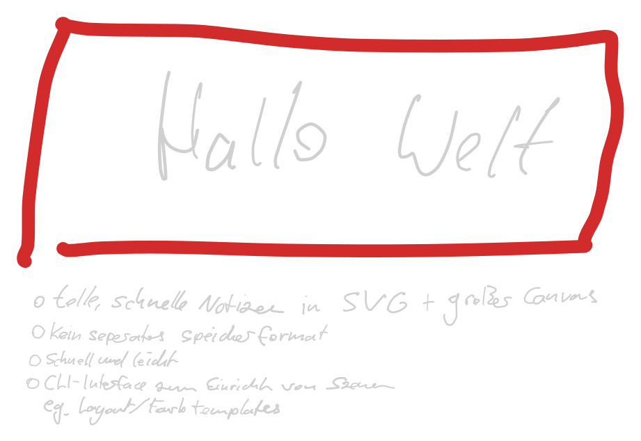

# Table of Contents

1.  [Controls](#orgd6ecc97)
2.  [CLI](#org4ac8846)

A small, fast tool for quick note taking / sketching with direct SVG output. Can be integrated into other apps through CLI.

    cabal run sketch -- notes.svg

# Controls

-   1-9 Color select (0 = eraser)
-   +/- Stroke Width
-   Barrel-Button Pan
-   Usual Mouse Movement + Undo/Redo

# CLI

    Usage: sketch [FILE] [-o OUT.svg] [--width PIXELS] [--smoothing PIXELS] 
                  [--colors #RGB,...]
    
      Draw handwritten notes on an endless canvas.
    
    Available options:
      FILE                     the drawing to open, or start, and save to
                               (default: "sketch.svg")
      -o OUT.svg               Output Path, FILE is only the initial Canvas
      --width PIXELS           the pen's width at full pressure (default: 6.0)
      --smoothing PIXELS       Pen Sample Merge Distance (default: 1.5)
      --colors #RGB,...        the colours keys 1 to 9 pick, as #RGB or #RRGGBB
      -h,--help                Show this help text

